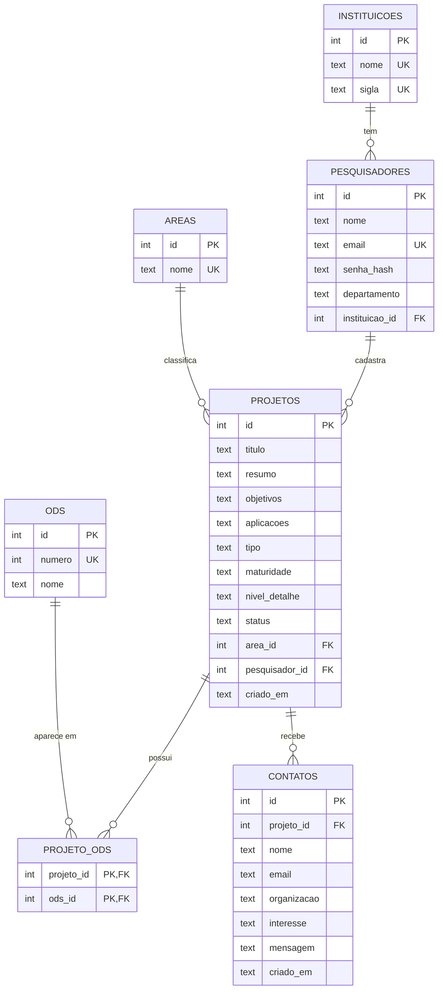

# Modelagem do Banco de Dados - Sinapse Recife

Banco: **SQLite** · Scripts: [`schema.sql`](schema.sql) (criação) e [`seed.sql`](seed.sql) (dados de exemplo).

## Modelo lógico (diagrama entidade-relacionamento)

## Dicionário de dados (resumo)

| Tabela | Finalidade | Relacionamentos |
|---|---|---|
| `instituicoes` | Universidades e centros parceiros (UFPE, UPE, IFPE, CESAR School) | 1 instituição : N pesquisadores |
| `areas` | Áreas do conhecimento usadas nos filtros | 1 área : N projetos |
| `ods` | Objetivos de Desenvolvimento Sustentável da ONU | N:N com projetos (`projeto_ods`) |
| `pesquisadores` | Usuários que cadastram projetos; senha guardada como hash | 1 pesquisador : N projetos |
| `projetos` | Pesquisas publicadas no Hub | N:N com ODS; 1 projeto : N contatos |
| `projeto_ods` | Tabela associativa entre projetos e ODS | chave composta (`projeto_id`, `ods_id`) |
| `contatos` | Pedidos de contato enviados aos pesquisadores | N contatos : 1 projeto |

## Regras de negócio no banco

- `projetos.tipo` aceita apenas: Tese, Dissertação, Protótipo, Patente, Projeto.
- `projetos.status`: `rascunho` ou `publicado` (só publicados aparecem na busca).
- `projetos.nivel_detalhe` (`resumo`, `resumo_objetivos`, `completo`) controla o que fica público, protegendo a propriedade intelectual.
- `contatos.interesse` aceita: Parceria, Projeto-piloto, Informações.
- Chaves estrangeiras ativas (`PRAGMA foreign_keys = ON`); apagar um projeto apaga seus contatos e vínculos com ODS.
- A instituição do projeto é obtida pelo pesquisador responsável, evitando dado repetido (3ª forma normal).
